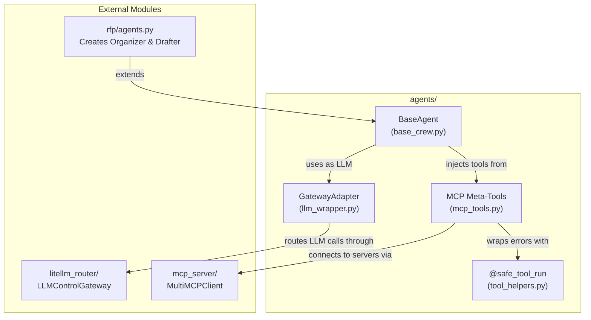

# `agents/` — Core Agent Framework

> The foundational layer that powers every AI agent in **RFP Intelligence**. This module provides the base agent class, LLM gateway bridge, and universal MCP tool wrappers that all domain-specific agents (like the RFP pipeline) inherit from.

---

## Folder Structure

```
agents/
├── __init__.py              # UTF-8 encoding fix for Windows terminals
├── core/
│   ├── __init__.py          # Exports get_crewai_llm, _get_gateway
│   ├── base_crew.py         # BaseAgent class — inherited by all subagents
│   └── llm_wrapper.py       # GatewayAdapter — bridges CrewAI ↔ LiteLLM Gateway
└── utils/
    ├── __init__.py          # Exports safe_tool_run, ensure_mcp_connected
    ├── mcp_tools.py         # Universal MCP meta-tools (SearchMCPTools, CallMCPTool)
    └── tool_helpers.py      # @safe_tool_run decorator for error handling
```

---

## What This Module Does

The `agents/` module is the **shared infrastructure layer** that sits between the AI framework (CrewAI) and the rest of the system. It ensures that:

1. **Every agent uses the same LLM gateway** — No agent calls OpenAI/Gemini/Groq directly. All calls are routed through the `LiteLLM Gateway` for budget tracking, rate limiting, and automatic fallback.
2. **Every agent has access to MCP tools** — Agents can discover and call tools exposed by any connected MCP server (document reader, prompt server, etc.).
3. **Every agent has safety guardrails** — Anti-hallucination prompts, call count limits (max 3 per query), and 300-second timeout enforcement.

---

## File-by-File Breakdown

### `__init__.py`
Fixes Windows terminal UTF-8 encoding issues. When CrewAI agents print Unicode characters (box-drawing, emojis, etc.), Windows PowerShell can crash with encoding errors. This module automatically reconfigures `stdout` and `stderr` to UTF-8 on import.

### `core/base_crew.py` — `BaseAgent`
The **base class** that every subagent in the system extends. Instead of using raw `crewai.Agent`, all agents inherit from `BaseAgent` which provides:

| Feature | Implementation |
|---------|---------------|
| **LLM Wiring** | Automatically injects the `GatewayAdapter` as the agent's LLM |
| **MCP Tool Injection** | Accepts `mcp_servers=["server-name"]` and auto-loads tools from those servers |
| **Tool Filtering** | Accepts `allowed_tools=["tool_name"]` to restrict which tools an agent can use |
| **Call Limit** | Max 3 invocations per agent per query — prevents infinite loops |
| **Timeout** | 300-second hard timeout per task execution |
| **Anti-Hallucination** | Injects guardrail instructions into every agent's backstory |

### `core/llm_wrapper.py` — `GatewayAdapter`
The **bridge** between CrewAI and the LiteLLM Gateway. This is the most critical file in the agent layer.

**How it works:**
1. CrewAI calls `GatewayAdapter.call(messages)` when an agent needs to think
2. The adapter forwards the messages to `LLMControlGateway.generate_response_from_messages()`
3. The Gateway handles model selection, budget checks, and rate limiting
4. The response flows back through the adapter with anti-hallucination enforcement

**Key safety features:**
- **Prompt rewriting**: Replaces CrewAI's aggressive "your job depends on it!" prompt with tool-execution instructions
- **Observation interception**: If the LLM simulates its own tool output (a common hallucination), the adapter truncates the response before `Observation:` to force the real tool to execute
- **Error truthfulness**: If all tool calls failed, prevents the agent from fabricating a "Final Answer" with made-up data
- **90-second timeout**: Hard limit per LLM call to prevent runaway API costs

### `utils/mcp_tools.py` — Universal MCP Meta-Tools
Provides two CrewAI `BaseTool` wrappers that let any agent interact with MCP servers:

| Tool | Purpose |
|------|---------|
| `SearchMCPTools` | Discovers available tools across all connected MCP servers by keyword search |
| `CallMCPTool` | Executes any discovered tool by name + JSON arguments |

Also manages a **singleton MCP client** with a dedicated background asyncio event loop (required because CrewAI runs synchronously but MCP uses async).

### `utils/tool_helpers.py` — `@safe_tool_run`
A decorator that wraps any tool's `_run()` method with standardized error handling. Instead of writing try/except in every tool, tools use:
```python
@safe_tool_run("My Tool")
def _run(self, query: str) -> str:
    ...  # no try/except needed
```
On error, returns a clean `[My Tool Error] FileNotFoundError: file.csv not found` string back to the agent.

---

## Technology Choices

### Why CrewAI?
- **Role-based agents**: CrewAI's agent model maps perfectly to our pipeline — each agent has a clear role (Organizer, Drafter) with specific tools and goals
- **Sequential process**: Built-in support for `Process.sequential` where output from one agent feeds into the next
- **Tool integration**: Native `BaseTool` class that we extend for MCP and Qdrant tools
- **ReAct loop**: Agents use Thought → Action → Observation cycles, giving us interception points for anti-hallucination enforcement

### Why a Custom LLM Adapter (not direct CrewAI LLM)?
- **Budget control**: Every LLM call must go through our `BudgetTracker` — direct CrewAI LLM usage would bypass cost controls
- **Multi-model routing**: The adapter delegates to our `EnterpriseRouter` which can fall back across OpenAI → Gemini → Groq
- **Observability**: Every call generates a terminal receipt with model, cost, tokens, and time
- **Prompt safety**: We need to intercept and modify CrewAI's internal prompts to prevent hallucination

---

## Data Flow Diagram



---

## Cross-Module Dependencies

### Who imports from `agents/`?

| External File | What It Imports | Purpose |
|---------------|-----------------|---------|
| `rfp/agents.py` | `BaseAgent` | Organizer and Drafter agents extend `BaseAgent` |
| `rfp/rfp_orchestrator.py` | `get_crewai_llm`, `_get_gateway`, `reset_subagent_call_counts`, `ensure_mcp_connected` | Orchestrator initializes the gateway and MCP connections |

### What does `agents/` import from other modules?

| This File | Imports From | What |
|-----------|-------------|------|
| `core/llm_wrapper.py` | `litellm_router.gateway` | `LLMControlGateway` — the actual LLM engine |
| `core/llm_wrapper.py` | `litellm_router.cli` | `GatewayCLI._render()` — prints terminal receipts |
| `core/base_crew.py` | `crewai` | `Agent` base class |
| `utils/mcp_tools.py` | `mcp_server.client` | `MultiMCPClient` — connects to MCP servers |
