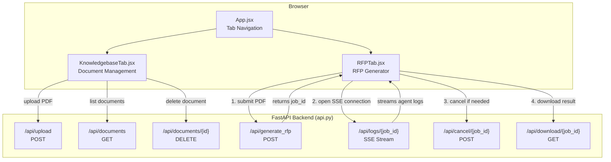

# `frontend/` — RFP Intelligence Web Interface

> The **user-facing web application** for **RFP Intelligence**. A modern React single-page application that provides a two-tab interface: a Knowledgebase management panel for uploading company documents, and an RFP Generator chat interface that shows real-time agent activity while processing RFP documents.

---

## Folder Structure

```
frontend/
├── index.html                   # HTML entry point — loads main.jsx
├── package.json                 # Dependencies: React, Vite, Axios, Lucide
├── vite.config.js               # Vite configuration with React plugin
├── .gitignore                   # Git ignore rules for node_modules, dist
├── public/
│   ├── favicon.svg              # Custom app favicon
│   └── icons.svg                # SVG icon sprite
└── src/
    ├── main.jsx                 # React root — renders <App /> into #root
    ├── App.jsx                  # Main app with tab navigation + toast system
    ├── index.css                # Complete design system (glassmorphism, dark mode)
    ├── assets/
    │   └── hero.png             # Hero image asset
    └── components/
        ├── KnowledgebaseTab.jsx # Document upload, listing, and deletion UI
        └── RFPTab.jsx           # RFP Generator — chat UI + real-time agent logs
```

---

## What This Module Does

The frontend provides two main features:

### 1. Knowledgebase Ingestion Tab
- **Upload PDFs**: Drag-and-drop or file picker to upload company documents
- **Document list**: Shows all uploaded documents with their status, file hash, and chunk count
- **Delete documents**: Remove individual documents from the vector database
- **Real-time feedback**: Toast notifications for upload success/failure

### 2. RFP Generator Tab
- **File attachment**: Upload an RFP PDF to process
- **Real-time agent logs**: Server-Sent Events (SSE) stream shows live agent activity with:
  - Agent name and current task
  - Expandable "Thinking" sections showing agent reasoning
  - Tool calls and their results
  - Cost, tokens, time, and budget telemetry in real-time
- **PDF download**: Completed RFP response PDF appears as a clickable download card
- **Job cancellation**: Stop button to cancel long-running generation jobs
- **Resizable sidebar**: Drag handle to resize the telemetry sidebar

---

## File-by-File Breakdown

### `App.jsx` — Main Application
The root component with:
- **Tab navigation**: Switches between "RFP Generator" and "Knowledgebase Ingestion" tabs
- **Toast notification system**: Success/error/warning toasts with 4-second auto-dismiss
- **Global layout**: Header bar with "RFP Intelligence" branding

### `components/RFPTab.jsx` — RFP Generator
The largest and most complex component (~730 lines). Key features:

| Feature | Implementation |
|---------|---------------|
| **File upload** | FormData POST to `/api/generate_rfp` with PDF file |
| **SSE streaming** | `EventSource` connection to `/api/logs/{job_id}` for real-time log events |
| **Log parsing** | Regex-based parser that groups raw log lines into structured agent blocks with thinking, tools, and observations |
| **Telemetry sidebar** | Displays live cost (`$0.000XXX`), token count, budget remaining, and elapsed time |
| **Agent visualization** | Each agent's work appears as a chat bubble with expandable thinking/tool sections |
| **Job cancellation** | POST to `/api/cancel/{job_id}` + closes SSE connection |

**Log parsing logic** (inside `useMemo`):
Raw SSE log lines are parsed into structured blocks by detecting patterns like:
- `[START] Agent Name` → new agent block
- `Thought:` → agent reasoning (collapsible)
- `Action:` / `Action Input:` → tool call
- `Tool Output` / `Observation:` → tool result
- `Model Selected:` → LLM receipt data
- `[SESSION SUMMARY]` → final metrics

### `components/KnowledgebaseTab.jsx` — Knowledgebase Manager
Manages the company document library:

| Feature | API Endpoint |
|---------|-------------|
| Upload PDF | `POST /api/upload` (multipart form) |
| List documents | `GET /api/documents` |
| Delete document | `DELETE /api/documents/{id}` |
| Check status | Response includes `status`, `chunk_count`, `file_hash` |

### `index.css` — Design System
A comprehensive CSS design system (~10,700 lines) implementing:

| Design Element | Implementation |
|----------------|---------------|
| **Dark mode** | CSS custom properties with dark palette (slate/zinc tones) |
| **Glassmorphism** | `backdrop-filter: blur()` + semi-transparent backgrounds |
| **Smooth animations** | `@keyframes` for pulse, slide-in, fade effects |
| **Responsive layout** | Flexbox-based with `min-width` constraints |
| **Custom scrollbars** | Styled `::-webkit-scrollbar` for dark theme consistency |
| **Chat bubbles** | User (right-aligned, indigo) vs Agent (left-aligned, dark) |
| **Code blocks** | Monospace with syntax-appropriate background |

---

## Technology Choices

### Why Vite (instead of Create React App or Next.js)?
- **Blazing fast HMR**: Vite uses native ES modules in development — changes reflect in <50ms vs. CRA's 2-5 seconds
- **Minimal config**: Zero-config React setup with `@vitejs/plugin-react`
- **Lightweight**: No SSR/routing overhead from Next.js — this is a single-page dashboard app, not a public website
- **Modern**: Built on ES modules and Rollup — produces optimized production bundles

### Why React (instead of Vue or vanilla JS)?
- **Component model**: Perfect for our two-tab layout with reusable toast notifications and shared state
- **Hooks**: `useState`, `useEffect`, `useMemo`, `useRef` cleanly manage SSE connections, log parsing, and UI state
- **Ecosystem**: Rich library of UI components (Lucide icons) and HTTP clients (Axios)

### Why Vanilla CSS (instead of Tailwind)?
- **Full design control**: Complex glassmorphism effects, custom scrollbars, and animations are easier to express in vanilla CSS
- **No build dependency**: CSS works without PostCSS pipeline or purging configuration
- **Single source of truth**: All design tokens (colors, spacing, fonts) defined as CSS custom properties in one file

### Why Axios (instead of fetch)?
- **FormData handling**: Automatic `Content-Type: multipart/form-data` header for file uploads
- **Error handling**: Consistent error objects with HTTP status codes
- **Interceptors**: Can add auth headers or retry logic globally (future-ready)

### Why Lucide React (for icons)?
- **Tree-shakable**: Only the icons you import are bundled — no 500KB icon font
- **React-native components**: `<FileText size={20} />` — no CSS class juggling
- **Consistent design**: Clean, modern line icons that match our dark-mode aesthetic

### Why Server-Sent Events (instead of WebSockets)?
- **Simpler protocol**: SSE is HTTP-based, works through proxies and load balancers without special configuration
- **One-way data flow**: Our use case is strictly server → client (agent logs streaming to browser) — SSE is designed exactly for this
- **Auto-reconnection**: Built-in browser reconnection on connection loss
- **No library needed**: Native `EventSource` API — zero dependencies

---

## Data Flow Diagram



---

## Cross-Module Dependencies

### Backend API Endpoints Used

| Component | Endpoint | Method | Purpose |
|-----------|----------|--------|---------|
| `KnowledgebaseTab` | `/api/upload` | POST | Upload PDF to knowledgebase |
| `KnowledgebaseTab` | `/api/documents` | GET | List all uploaded documents |
| `KnowledgebaseTab` | `/api/documents/{id}` | DELETE | Remove a document |
| `RFPTab` | `/api/generate_rfp` | POST | Start RFP generation job |
| `RFPTab` | `/api/logs/{job_id}` | GET (SSE) | Stream real-time agent logs |
| `RFPTab` | `/api/cancel/{job_id}` | POST | Cancel running job |
| `RFPTab` | `/api/download/{job_id}` | GET | Download generated PDF |

### Runtime Dependencies

| Package | Version | Purpose |
|---------|---------|---------|
| `react` | 19.2.7 | UI component framework |
| `react-dom` | 19.2.7 | DOM rendering |
| `axios` | 1.18.1 | HTTP client for API calls |
| `lucide-react` | 1.27.0 | Icon library |
| `vite` | 8.1.1 | Dev server + build tool |
| `@vitejs/plugin-react` | 6.0.3 | React Fast Refresh for Vite |

### How to Run

```bash
# Development (from frontend/ directory)
npm run dev

# Production build
npm run build

# Preview production build
npm run preview
```

The dev server runs on `http://localhost:5173` and proxies API calls to the FastAPI backend at `http://localhost:8000`.
