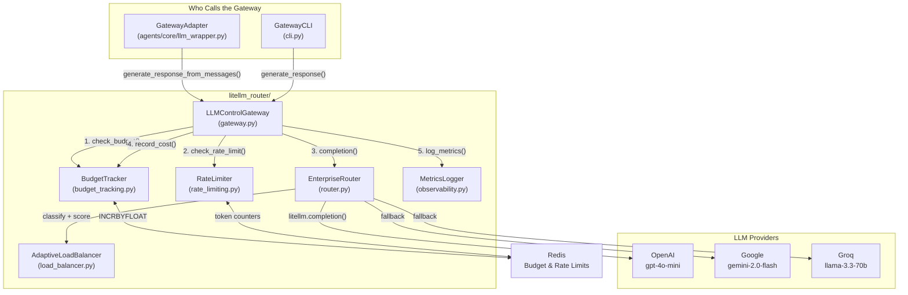

# `litellm_router/` — LLM Control Gateway

> The **enterprise LLM management layer** for **RFP Intelligence**. Every AI model call in the entire system — whether from the Organizer agent, the Drafter agent, or the task classifier — flows through this gateway for intelligent routing, budget protection, rate limiting, and observability.

---

## Folder Structure

```
litellm_router/
├── __init__.py                  # Exports LLMControlGateway, GenerationResult
├── gateway.py                   # Main gateway — the single entry point for all LLM calls
├── config.py                    # AppConfig — model definitions, API keys, Redis settings
├── cli.py                       # GatewayCLI — interactive terminal + receipt renderer
├── observability.py             # MetricsLogger — cost/time tracking per call
├── protections/
│   ├── __init__.py
│   ├── budget_tracking.py       # BudgetTracker — Redis-backed monthly spend limits
│   └── rate_limiting.py         # RateLimiter — token-per-minute throttling
├── routing/
│   ├── __init__.py
│   ├── router.py                # EnterpriseRouter — task classification + multi-factor scoring
│   └── load_balancer.py         # AdaptiveLoadBalancer — health tracking + latency-aware routing
└── utils/
    ├── __init__.py
    ├── cache_client.py          # CacheClient — Redis connection wrapper
    ├── env_loader.py            # EnvLoader — .env file loading
    ├── llm_client.py            # LLMClient — thin wrapper around litellm.completion()
    ├── text_parser.py           # TextParser — keyword extraction for task classification
    └── time_utils.py            # TimeTracker — latency measurement utilities
```

---

## What This Module Does

The `litellm_router/` module is the **control plane** for all LLM interactions. It answers three critical questions for every request:

1. **Which model should handle this?** → Task classification + multi-factor scoring → automatic routing to the best model
2. **Can we afford it?** → Redis-backed budget tracking → blocks requests when monthly spend limit is reached
3. **Is it going too fast?** → Token-per-minute rate limiting → prevents API throttling from providers

**Every single LLM call in RFP Intelligence goes through this gateway** — there are zero direct `openai.completion()` calls anywhere in the codebase.

---

## File-by-File Breakdown

### `gateway.py` — `LLMControlGateway`
The **main entry point** for all LLM calls. Exposes two methods:

| Method | Used By | Purpose |
|--------|---------|---------|
| `generate_response(prompt)` | CLI interactive mode | Simple string-in, result-out |
| `generate_response_from_messages(messages)` | Agent layer (`GatewayAdapter`) | Full message list with system/user roles preserved |

**Request lifecycle:**
1. Pre-flight: `BudgetTracker.check_budget()` → `RateLimiter.check_rate_limit()`
2. Routing: `GatewayRouter.completion(messages)` → picks model, falls back on failure
3. Post-flight: Calculate cost → `record_cost()` → `record_usage()` → return `GenerationResult`

### `config.py` — `AppConfig`
Central configuration for the gateway:

| Setting | Value |
|---------|-------|
| **Models** | `gpt-4o-mini` (OpenAI), `gemini/gemini-2.0-flash` (Google), `groq/llama-3.3-70b-versatile` (Groq) |
| **API Keys** | Auto-detected from `.env` — only models with valid keys are available |
| **Redis** | Connection settings for budget/rate-limit persistence |

### `routing/router.py` — `EnterpriseRouter`
The **intelligent routing engine** that decides which model handles each request.

**Two-phase routing:**

**Phase 1 — Task Classification** (keyword-based with LLM fallback):
```
"code", "python", "api"       → coding
"summarize", "tldr"           → summarization
"draft", "answer", "write"    → creative_writing
"document", "rfp", "extract"  → document_analysis
(no match)                    → Groq LLM classifies
```

**Phase 2 — Multi-Factor Scoring:**
```
Score = 30% Quality + 20% Latency + 40% Cost + 10% Success Rate
```

Each model has pre-configured quality scores per task type. The router picks the highest-scoring healthy model and falls back through the ranked list if it fails.

### `routing/load_balancer.py` — `AdaptiveLoadBalancer`
Tracks real-time health of each model:
- **Latency (ms)**: Exponential moving average of response times
- **Success rate**: Rolling success/failure ratio
- **Health status**: Models that fail repeatedly are marked "Unhealthy" and receive a score of `-1` (skipped)
- **Active load**: Number of concurrent requests per model

### `protections/budget_tracking.py` — `BudgetTracker`
Redis-backed monthly spend tracker:
- Stores running total in Redis key `global_monthly_spend`
- Default limit: `$50.00/month` (configurable via `MAX_MONTHLY_BUDGET_USD` env var)
- Blocks all LLM calls with `BudgetExceededError` when limit is reached
- Shared across all processes (API server, CLI, agents)

### `protections/rate_limiting.py` — `RateLimiter`
Token-per-minute throttling to stay within provider API limits:
- Tracks tokens consumed in sliding time windows
- Raises `RateLimitExceededError` before sending a request that would exceed limits
- Prevents costly 429 errors from OpenAI/Gemini/Groq

### `cli.py` — `GatewayCLI`
Interactive terminal interface and **receipt renderer**:
- `GatewayCLI._render(result)` prints formatted receipts after every LLM call
- Shows: Model selected, fallback model (if used), time, cost, budget remaining, tokens used
- Used by `llm_wrapper.py` to print agent-level receipts in the terminal

### `observability.py` — `MetricsLogger`
Hooks into LiteLLM's success callback to record cost, time, and token usage for every call. Maintains an in-memory `call_logs` array for session-level analytics.

---

## Technology Choices

### Why LiteLLM (instead of direct OpenAI/Google/Groq SDKs)?
- **Unified API**: One `litellm.completion()` call works identically across OpenAI, Gemini, and Groq — zero provider-specific code
- **Automatic cost calculation**: `litellm.completion_cost()` knows the price of every model
- **Built-in callbacks**: `success_callback` hook powers our `MetricsLogger` without monkey-patching
- **Model name normalization**: Handles provider prefixes (`groq/`, `gemini/`) transparently

### Why Redis (for budget/rate-limit storage)?
- **Shared state**: Multiple processes (API server, CLI) see the same spend counter — prevents over-budget scenarios in concurrent usage
- **Atomic operations**: `INCRBYFLOAT` ensures accurate cost accumulation even under concurrent requests
- **Persistence**: Budget survives server restarts — no lost spend data

### Why Multi-Model Routing (instead of hardcoded GPT-4o)?
- **Cost optimization**: Groq (Llama 3.3) is ~95% cheaper than OpenAI for simple tasks like document analysis
- **Resilience**: If OpenAI is down, traffic automatically falls back to Gemini → Groq
- **Task-aware quality**: Document analysis routes to Groq (fastest), creative writing routes to OpenAI (highest quality)

---

## Data Flow Diagram



---

## Cross-Module Dependencies

### Who imports from `litellm_router/`?

| External File | What It Imports | Purpose |
|---------------|-----------------|---------|
| `agents/core/llm_wrapper.py` | `LLMControlGateway`, `GatewayCLI` | Bridges CrewAI agents to the gateway |
| `agents/core/llm_wrapper.py` | `AppConfig` | Initializes environment settings |
| `rfp/rfp_orchestrator.py` | `GenerationResult` | Return type for pipeline results |
| `rfp/tools.py` | `BudgetTracker` | Records embedding API costs |
| `api.py` | `BudgetTracker`, `AppConfig` | API server uses budget for telemetry display |

### What does `litellm_router/` import externally?

| This File | External Dependency | Purpose |
|-----------|-------------------|---------|
| `utils/llm_client.py` | `litellm` | Core LLM completion API |
| `utils/cache_client.py` | `redis` | Budget/rate-limit persistence |
| `utils/env_loader.py` | `dotenv` | Load `.env` file |
| `config.py` | `litellm_router.utils.*` | Internal utility modules |
