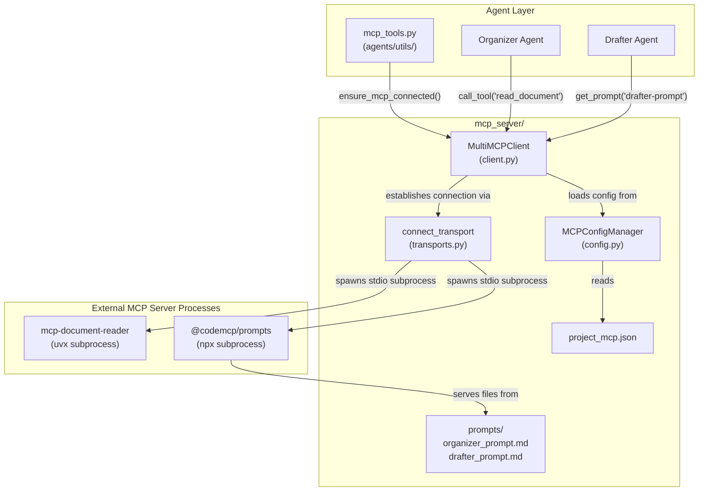

# `mcp_server/` — Model Context Protocol Client & Configuration

> The **MCP integration layer** for **RFP Intelligence**. This module manages connections to external MCP servers that provide document reading and prompt management capabilities to the AI agents. It is the bridge between the agent framework and the MCP ecosystem.

---

## Folder Structure

```
mcp_server/
├── __init__.py              # Exports MultiMCPClient, MCPConfigManager
├── client.py                # MultiMCPClient — unified multi-server MCP client
├── config.py                # MCPConfigManager — loads & resolves project_mcp.json
├── transports.py            # Transport layer — HTTP and Stdio connection handlers
├── project_mcp.json         # Server configuration — defines which MCP servers to connect to
└── prompts/
    ├── organizer_prompt.md  # Extraction rules for the Organizer agent
    └── drafter_prompt.md    # Drafting rules for the Drafter agent
```

---

## What This Module Does

The `mcp_server/` module implements the **client side** of the Model Context Protocol (MCP). It does NOT run MCP servers — instead, it:

1. **Reads configuration** from `project_mcp.json` to know which MCP servers exist
2. **Launches server processes** (via stdio subprocess) or connects to HTTP endpoints
3. **Manages sessions** — maintains persistent connections to each server
4. **Exposes a unified API** — agents call `client.call_tool()` or `client.get_prompt()` without knowing which server handles the request

Currently, **RFP Intelligence** connects to two MCP servers:

| Server | Type | Purpose |
|--------|------|---------|
| `mcp-document-reader` | Stdio (uvx) | Reads uploaded PDF/DOCX files and returns their text content |
| `prompts` | Stdio (npx) | Serves markdown prompt templates from the `prompts/` directory |

---

## File-by-File Breakdown

### `client.py` — `MultiMCPClient`
The **unified MCP client** that can connect to multiple servers simultaneously.

| Method | Purpose |
|--------|---------|
| `connect(server_names)` | Connects to specified servers (or all if None) |
| `call_tool(server, tool, args)` | Executes a tool on a specific server |
| `get_prompt(server, prompt_name)` | Fetches a prompt template from a server |
| `list_resources(server)` | Lists available resources on a server |
| `refresh_tool_cache()` | Caches tool-to-server mappings for fast lookup |
| `close()` | Gracefully shuts down all connections |

Uses `AsyncExitStack` for proper cleanup of subprocess connections and supports both `async with` context manager and manual lifecycle management.

### `config.py` — `MCPConfigManager`
Loads and parses `project_mcp.json`:
- **Environment variable resolution**: Expands `${VAR_NAME}` syntax in config values using `os.environ`
- **Path resolution**: Locates `project_mcp.json` relative to the module directory
- **Server config access**: `get_server_config(name)` returns a fully resolved config dict

### `transports.py` — Transport Layer
Handles the two MCP transport protocols:

| Transport | When Used | How It Works |
|-----------|-----------|-------------|
| **Streamable HTTP** | Server has a `"url"` in config | Connects via `httpx` async client + MCP's `streamable_http_client` |
| **Stdio** | Server has a `"command"` in config | Spawns a subprocess + communicates via stdin/stdout pipes |

**Windows-specific fix**: On Windows, `npx` commands that contain `&` characters break when run through `cmd.exe`. The transport layer detects Windows and rewrites `npx` commands to run `node.exe` directly with `npx-cli.js`, bypassing the shell entirely.

### `project_mcp.json` — Server Configuration
Defines which MCP servers to connect to:

```json
{
  "mcpServers": {
    "mcp-document-reader": {
      "command": "uvx",
      "args": ["--with", "fastmcp", "mcp-documents-reader"],
      "env": { "UV_LINK_MODE": "copy" }
    },
    "prompts": {
      "command": "cmd",
      "args": ["/c", "npx", "-y", "@codemcp/prompts"],
      "env": { "PROJECT_DIR": "...path.../mcp_server" }
    }
  }
}
```

- **mcp-document-reader**: Runs via `uvx` (Python package runner). Provides `read_document` tool that extracts text from PDFs.
- **prompts**: Runs via `npx` (Node.js package runner). Serves the markdown files in `prompts/` as MCP prompt resources.

### `prompts/organizer_prompt.md`
Guidelines served to the Organizer agent via the prompts MCP server:
- Extract questions verbatim — don't infer or invent
- Exclude rubric/grading criteria sections
- Output strict JSON array format with `question` and `extra_info` fields

### `prompts/drafter_prompt.md`
Guidelines served to the Drafter agent via the prompts MCP server:
- Base answers exclusively on provided context
- Output "Information not available in Knowledgebase" when context is missing
- Use professional, authoritative, concise tone
- Strict JSON array output format

---

## Technology Choices

### Why MCP (Model Context Protocol)?
- **Standardized tool interface**: MCP provides a universal protocol for AI agents to discover and call tools — no custom API integrations needed per tool
- **Process isolation**: Each MCP server runs as a separate process, preventing tool crashes from affecting the main application
- **Hot-swappable**: New tools can be added by updating `project_mcp.json` without changing agent code
- **Ecosystem**: Growing library of pre-built MCP servers (document readers, file systems, databases, etc.)

### Why Stdio Transport (instead of HTTP)?
- **Zero infrastructure**: Servers launch as child processes — no Docker, no separate deployments
- **Automatic lifecycle**: Servers start when the agent pipeline starts, stop when it stops
- **Local performance**: No network latency — communication happens through OS pipes

### Why Separate Prompt Files (instead of hardcoded strings)?
- **Version control**: Prompt changes are Git-trackable diffs, not buried in Python code
- **MCP-served**: The `@codemcp/prompts` server makes prompts available as MCP resources — agents can fetch them dynamically
- **Non-developer editable**: Product managers can modify prompts without touching Python code

---

## Data Flow Diagram



---

## Cross-Module Dependencies

### Who imports from `mcp_server/`?

| External File | What It Imports | Purpose |
|---------------|-----------------|---------|
| `agents/utils/mcp_tools.py` | `MultiMCPClient` | Singleton MCP client used by all agents |

### What does `mcp_server/` import externally?

| This File | External Dependency | Purpose |
|-----------|-------------------|---------|
| `client.py` | `mcp` (MCP SDK) | `ClientSession` — the MCP protocol session |
| `transports.py` | `mcp.client.stdio` | `stdio_client`, `StdioServerParameters` — subprocess transport |
| `transports.py` | `mcp.client.streamable_http` | `streamable_http_client` — HTTP transport |
| `transports.py` | `httpx` | Async HTTP client for streamable HTTP connections |
| `config.py` | `dotenv` | Environment variable loading |
