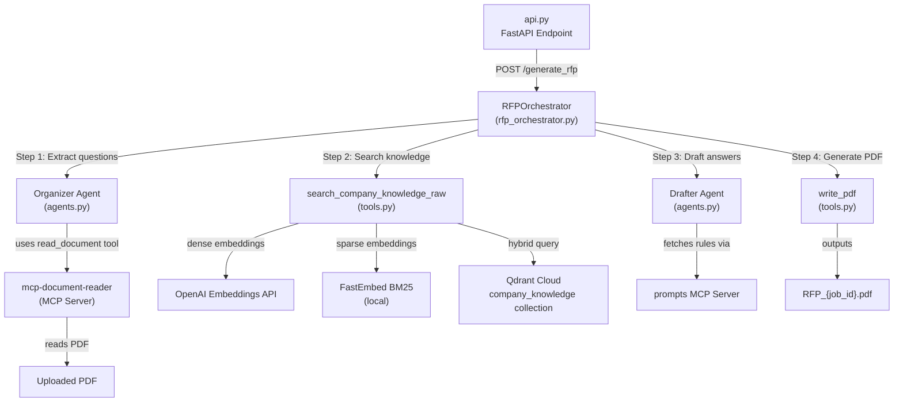

# `rfp/` — RFP Processing Pipeline

> The domain-specific pipeline that powers the core feature of **RFP Intelligence**: reading an RFP document, extracting questions, searching the company knowledgebase, and drafting professional answers — all automatically.

---

## Folder Structure

```
rfp/
├── __init__.py              # Package marker
├── rfp_orchestrator.py      # Sequential pipeline controller (the brain)
├── agents.py                # Organizer & Drafter agent definitions
└── tools.py                 # Database Search Tool + PDF Writer
```

---

## What This Module Does

The `rfp/` module implements the **end-to-end RFP response generation workflow**:

1. **Extract** — The Organizer agent reads the uploaded PDF and extracts all RFP questions into structured JSON
2. **Search** — The Orchestrator batches questions (3 at a time) and runs hybrid vector search against the Qdrant knowledgebase
3. **Draft** — The Drafter agent writes professional answers using only the retrieved context (no hallucination)
4. **Generate** — The final answers are stitched together and exported as a formatted PDF

This is a **code-orchestrated sequential pipeline** — not an LLM-managed one. The `RFPOrchestrator` controls the exact flow, guaranteeing perfect context handoff between agents without truncation.

---

## File-by-File Breakdown

### `rfp_orchestrator.py` — `RFPOrchestrator`
The **brain of the pipeline**. This is where the sequential workflow is hardcoded in Python (not delegated to an LLM manager).

**Pipeline stages:**

| Stage | What Happens |
|-------|-------------|
| **1. MCP Init** | Connects to `mcp-document-reader` and `prompts` MCP servers |
| **2. Extract** | Creates a CrewAI `Crew` with the Organizer agent → reads PDF → outputs JSON array of questions |
| **3. Parse** | Robust JSON extraction with regex fallback → splits into batches of 3 questions |
| **4. Search** | For each batch, calls `search_company_knowledge_raw()` directly (bypasses CrewAI overhead for speed) |
| **5. Draft** | For each batch, creates a new CrewAI `Crew` with the Drafter agent → drafts answers from retrieved context |
| **6. Validate** | Parses Drafter output as JSON, retries up to 2x if count mismatch |
| **7. Clean** | Strips hallucinated tool-call artifacts, markdown asterisks, and stray `Action:` lines |
| **8. PDF** | Calls `write_pdf()` to generate the final formatted PDF |

**Key design decisions:**
- **Batch size of 3**: Balances LLM context window usage vs. number of API calls
- **Direct function calls for search**: The orchestrator calls `search_company_knowledge_raw()` directly instead of going through CrewAI's tool execution — this eliminates ~5 seconds of overhead per batch
- **Question + extra_info search**: Both the question text and its surrounding PDF context are sent to the vector search for better retrieval accuracy

### `agents.py` — Agent Definitions
Defines the two specialized agents used in the pipeline:

| Agent | Role | MCP Server | Allowed Tools |
|-------|------|-----------|---------------|
| **Organizer** | Reads the RFP PDF and extracts all questions into structured JSON | `mcp-document-reader` | `read_document` only |
| **Drafter** | Writes professional answers using retrieved context | `prompts` | `get_drafter_prompt` only |

Both agents extend `BaseAgent` (from `agents/core/base_crew.py`) and include:
- A `step_callback` that formats agent thinking for the frontend's real-time log display
- Tool restrictions via `allowed_tools` to prevent agents from using wrong tools
- `max_iter=4` to limit ReAct loop iterations

### `tools.py` — Database Search & PDF Generation

#### `search_company_knowledge_raw(questions: str)`
The **hybrid vector search engine** that retrieves relevant context from the company knowledgebase.

**Search pipeline:**
1. Takes all questions as a newline-separated string
2. **Dense embeddings**: Calls OpenAI `text-embedding-3-small` via LiteLLM for semantic vectors
3. **Sparse embeddings**: Uses FastEmbed `Qdrant/bm25` model for keyword matching
4. **Hybrid fusion**: Sends both dense + sparse prefetch queries to Qdrant with RRF (Reciprocal Rank Fusion)
5. **Returns**: Top 3 context chunks per question with source attribution

#### `write_pdf(content: str, filename: str)`
Generates a professionally formatted PDF using FPDF2:
- Bold "Question X:" headers
- Normal-weight answers
- Indented list items
- Latin-1 safe encoding with Unicode character replacement
- Proper margins (20mm left/right, 20mm top, 15mm bottom)

---

## Technology Choices

### Why Qdrant (Vector Database)?
- **Hybrid search**: Native support for combining dense (semantic) and sparse (BM25 keyword) vectors in a single query via RRF fusion — critical for RFP retrieval where exact terminology matters alongside semantic meaning
- **Cloud-hosted**: Qdrant Cloud eliminates infrastructure management — just connect with URL + API key
- **Batch queries**: `query_batch_points()` API lets us search all questions in a single network round-trip

### Why FastEmbed (BM25)?
- **Local execution**: Runs entirely in-memory without API calls — zero cost for sparse embeddings
- **Qdrant-native format**: Output is directly compatible with Qdrant's `SparseVector` type
- **Speed**: Sub-millisecond embedding generation for keyword vectors

### Why OpenAI `text-embedding-3-small`?
- **Best price/performance**: $0.02 per million tokens — cheapest high-quality embedding model available
- **1536 dimensions**: Sufficient for RFP-style enterprise text without excessive storage
- **LiteLLM compatible**: Cost tracking works automatically through our budget system

### Why FPDF2 (PDF Generation)?
- **Zero external dependencies**: Pure Python, no LaTeX or wkhtmltopdf required
- **Lightweight**: ~100KB library vs. ReportLab's multi-MB footprint
- **Simple API**: Perfect for structured Q&A documents that don't need complex layouts

---

## Data Flow Diagram



---

## Cross-Module Dependencies

### Who imports from `rfp/`?

| External File | What It Imports | Purpose |
|---------------|-----------------|---------|
| `api.py` | `RFPOrchestrator` | FastAPI endpoint creates and runs the orchestrator |
| `run.py` | `RFPOrchestrator` | Interactive CLI entry point |
| `tests/test_rfp_orchestrator.py` | `RFPOrchestrator` | Unit tests for the pipeline |

### What does `rfp/` import from other modules?

| This File | Imports From | What |
|-----------|-------------|------|
| `rfp_orchestrator.py` | `agents.core.llm_wrapper` | `_get_gateway` — accesses the singleton LLM gateway |
| `rfp_orchestrator.py` | `agents.core.base_crew` | `reset_subagent_call_counts` — resets per-query limits |
| `rfp_orchestrator.py` | `agents.utils.mcp_tools` | `ensure_mcp_connected` — initializes MCP connections |
| `rfp_orchestrator.py` | `litellm_router.gateway` | `GenerationResult` — return type for pipeline results |
| `rfp_orchestrator.py` | `crewai` | `Crew`, `Task`, `Process` — orchestration primitives |
| `agents.py` | `agents.core.base_crew` | `BaseAgent` — parent class for both agents |
| `tools.py` | `litellm_router.protections.budget_tracking` | `BudgetTracker` — records embedding costs |
| `tools.py` | `qdrant_client` | Qdrant SDK for vector search |
| `tools.py` | `fastembed` | BM25 sparse embedding model |
| `tools.py` | `litellm` | Embedding API calls + cost calculation |
| `tools.py` | `fpdf` | PDF generation |
